# PostgreSQL ve Makine Öğrenmesi ile Mağaza Satış Tahmini

**Python | PostgreSQL 18 | Scikit-learn | Streamlit | Veri Analizi | Machine Learning**

## 1. Proje Hakkında

Bu projede geçmiş satış verilerini kullanarak mağazaların gelecekteki satış miktarlarını tahmin eden bir sistem geliştirdim.

PostgreSQL veritabanı ile Python tabanlı makine öğrenmesi modellerini entegre ederek veri aktarımı, veri ön işleme, model eğitimi, performans değerlendirmesi, satış tahmini ve sonuçların görselleştirilmesi aşamalarını gerçekleştirdim.

Ayrıca Streamlit kullanarak satış tahminlerinin ve analiz sonuçlarının görüntülenebildiği web tabanlı bir kullanıcı arayüzü geliştirdim.

### Projenin Öne Çıkan Özellikleri

- 19.454.838 satış kaydı
- 144 mağaza ve 699 üründen oluşan veri seti
- 19 PostgreSQL tablosu
- Üç farklı makine öğrenmesi modeli
- 139 mağaza için 59 günlük satış tahmini
- Her model için 8.201 tahmin
- PostgreSQL ve Python arasında çift yönlü veri akışı
- Mağaza bazlı performans analizleri
- Farklı model doğrulama yöntemleri
- Veritabanı indeks performans analizi
- Streamlit tabanlı kullanıcı arayüzü
- Model, mağaza ve tarih bazlı filtreleme
- Tahmin sonuçlarını CSV olarak indirme
- PostgreSQL üzerinden doğrudan veri gösterimi

## 2. Kullanılan Teknolojiler

| Teknoloji | Kullanım Amacı |
|---|---|
| Python 3.13.2 | Veri işleme ve model geliştirme |
| PostgreSQL 18 | Veri saklama ve SQL analizleri |
| pandas | Veri hazırlama ve analiz |
| NumPy | Sayısal hesaplamalar |
| scikit-learn | Makine öğrenmesi |
| Matplotlib | Veri görselleştirme |
| psycopg2 | PostgreSQL bağlantısı |
| joblib | Model kaydetme ve yükleme |
| Streamlit 1.67.0 | Web tabanlı kullanıcı arayüzü |
| pgAdmin 4 | Veritabanı yönetimi |
| Visual Studio Code | Kod geliştirme |
| Git ve GitHub | Sürüm kontrolü |

## 3. Veri Seti

Projede 2017–2019 yılları arasındaki satış, mağaza ve ürün verileri kullanılmıştır.

| Veri Grubu | Kayıt Sayısı |
|---|---:|
| Satış verileri | 19.454.838 |
| Mağaza verileri | 144 |
| Ürün verileri | 699 |
| Günlük mağaza satış verileri | 136.150 |
| Eğitim verileri | 622.454 |
| Test verileri | 286.304 |
| Tahmin yapılan mağazalar | 139 |
| Her model için tahmin kayıtları | 8.201 |

### Ham Veri Dosyaları

- sales.csv
- product_hierarchy.csv
- store_cities.csv

Satış verilerinde ürün kimliği, mağaza kimliği, tarih, satış miktarı, gelir, stok, fiyat ve promosyon bilgileri bulunmaktadır.

Mağaza verilerinde mağaza kimliği, mağaza türü, mağaza büyüklüğü ve şehir bilgileri bulunmaktadır.

Ürün verilerinde ürün kimliği, fiziksel boyutlar ve kategori hiyerarşisi bilgileri bulunmaktadır.

Ham satış verileri 2 Ocak 2017 ile 29 Aralık 2019 tarihleri arasını kapsamaktadır.

## 4. Sistem Mimarisi

Proje, veritabanı ve makine öğrenmesi arasında iki yönlü veri akışı sağlayacak şekilde geliştirilmiştir.
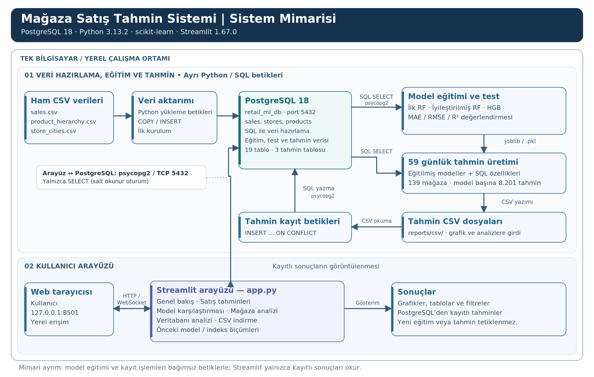

[Düzenlenebilir mimari diyagram (SVG)](docs/mimari_diyagram.svg)

### Sistem Bileşenleri

| Bileşen | Görevi |
|---|---|
| Ham veri dosyaları | Satış, ürün ve mağaza verilerini sağlar |
| PostgreSQL | Ham verileri, hazırlanan veri setlerini ve tahmin sonuçlarını saklar |
| Python | Veri aktarımı, model eğitimi ve tahmin işlemlerini gerçekleştirir |
| Scikit-learn | Makine öğrenmesi algoritmalarını sağlar |
| Joblib | Eğitilmiş modellerin saklanmasını sağlar |
| Streamlit | Kullanıcı arayüzünü oluşturur |
| Web tarayıcısı | Kullanıcının uygulama ile etkileşim kurmasını sağlar |

Sistem yerel bilgisayarda çalışmaktadır. Python ve Streamlit uygulaması PostgreSQL sunucusuna psycopg2 üzerinden TCP/IP bağlantısı ile erişmektedir.

PostgreSQL bağlantı noktası 5432, Streamlit uygulamasının bağlantı noktası ise 8501'dir.

Kullanıcı arayüzü PostgreSQL veritabanına salt okunur işlemlerle erişmektedir.

## 5. PostgreSQL Entegrasyonu

Projede retail_ml_db isimli PostgreSQL veritabanı kullanılmıştır.

Ham veriler Python üzerinden PostgreSQL'e aktarılmıştır. Eğitim ve test verileri SQL sorgularıyla alınmış, makine öğrenmesi modellerinin oluşturduğu tahminler tekrar veritabanına kaydedilmiştir.

### Temel Veritabanı Tabloları

| Tablo | Açıklama |
|---|---|
| sales | Ham satış kayıtları |
| stores | Mağaza bilgileri |
| products | Ürün bilgileri |
| magaza_gunluk | Günlük mağaza satış özetleri |
| tahmin_donemleri | Tahmin başlangıç tarihleri |
| donem_gecmis_ozet | Geçmiş satış ortalamaları |
| donem_gecmis_temiz | Temizlenmiş geçmiş satış verileri |
| yeni_ml_egitim | Makine öğrenmesi veri seti |
| yeni_ml_egitim_temiz | Model eğitim verileri |
| yeni_ml_test | Model test verileri |
| magaza_gecmis_ozet | Mağaza geçmiş satış ortalamaları |
| gelecek_tahmin_verisi | Gelecek satış tahmini verileri |

### Tahmin Tabloları

| Tablo | Açıklama |
|---|---|
| satis_tahminleri | İlk Random Forest tahminleri |
| satis_tahminleri_rf_iyilestirilmis | İyileştirilmiş Random Forest tahminleri |
| satis_tahminleri_hist_gradient | HistGradientBoosting tahminleri |

Tahmin tablolarında mağaza kimliği ve tahmin tarihi birleşik birincil anahtar olarak kullanılmaktadır.

Tekrar kayıt işlemlerinde aynı mağaza ve tarih için mükerrer kayıt oluşmasını önlemek amacıyla ON CONFLICT mekanizması kullanılmaktadır.

### SQL Dosyaları

| Dosya | Açıklama |
|---|---|
| [schema.sql](sql/schema.sql) | Veritabanı tablo ve indeks yapıları |
| [veri_hazirlama.sql](sql/veri_hazirlama.sql) | Günlük mağaza satış verileri |
| [egitim_test_hazirlama.sql](sql/egitim_test_hazirlama.sql) | Eğitim ve test veri setleri |
| [gelecek_tahmin_hazirlama.sql](sql/gelecek_tahmin_hazirlama.sql) | 59 günlük tahmin veri seti |
| [analiz_sorgulari.sql](sql/analiz_sorgulari.sql) | Model ve mağaza karşılaştırmaları |
| [performans_analizi.sql](sql/performans_analizi.sql) | İndeks performans analizi |

## 6. Veri Ön İşleme

Model eğitimi öncesinde satış verileri hazırlanmış ve eğitim-test ayrımı tarihsel olarak gerçekleştirilmiştir.

### Veri Hazırlama Aşamaları

1. Ham verilerin PostgreSQL'e aktarılması
2. Günlük mağaza satışlarının hesaplanması
3. Tahmin başlangıç dönemlerinin oluşturulması
4. Geçmiş satış ortalamalarının hesaplanması
5. Eksik geçmiş verilerin filtrelenmesi
6. Eğitim ve test veri setlerinin hazırlanması
7. Gelecek tahmin veri setinin oluşturulması

### Eğitim ve Test Dönemleri

| Veri Grubu | Başlangıç | Bitiş |
|---|---|---|
| Eğitim | 01.05.2017 | 31.12.2018 |
| Test | 07.01.2019 | 30.10.2019 |
| Gelecek tahmini | 01.11.2019 | 29.12.2019 |

### Modelde Kullanılan Özellikler

- Mağaza kimliği
- Tahmin günü
- Haftanın günü
- Ay
- Geçmiş 7 günlük satış ortalaması
- Geçmiş 28 günlük satış ortalaması
- Geçmiş 59 günlük satış ortalaması

Mağaza kimlikleri One-Hot Encoding yöntemiyle sayısal sütunlara dönüştürülmüştür.

Geçmiş satış ortalamalarının doğruluğu 4.860 grup üzerinde kontrol edilmiştir.

Model eğitiminde gelecekteki satış bilgilerinin geçmiş özellikler içerisine dahil edilmemesine dikkat edilmiştir.

## 7. Makine Öğrenmesi Modelleri

Projede üç farklı model geliştirilmiştir.

### İlk Random Forest

```python
RandomForestRegressor(
    n_estimators=50,
    max_depth=15,
    random_state=42,
    n_jobs=-1
)
```

### İyileştirilmiş Random Forest

```python
RandomForestRegressor(
    n_estimators=100,
    max_depth=20,
    min_samples_leaf=5,
    max_features=0.8,
    random_state=42,
    n_jobs=-1
)
```

### HistGradientBoosting

```python
HistGradientBoostingRegressor(
    max_iter=200,
    max_depth=10,
    learning_rate=0.05,
    min_samples_leaf=20,
    random_state=42
)
```

Eğitilmiş modeller joblib kullanılarak models klasörüne kaydedilmiştir.

## 8. Model Performans Karşılaştırması

Modeller MAE, RMSE ve R² metrikleri kullanılarak değerlendirilmiştir.

- MAE: Ortalama mutlak tahmin hatası
- RMSE: Büyük tahmin hatalarına daha duyarlı hata metriği
- R²: Modelin hedef değişkendeki değişkenliği açıklama düzeyini gösteren metrik

MAE ve RMSE değerlerinin düşük, R² değerinin yüksek olması tercih edilmektedir.

### Genel Test Sonuçları

| Model | MAE | RMSE | R² |
|---|---:|---:|---:|
| İlk Random Forest | 15,12 | 32,54 | 0,695 |
| İyileştirilmiş Random Forest | **14,77** | 31,18 | 0,720 |
| HistGradientBoosting | 14,81 | **30,75** | **0,728** |

Random Forest modelinin parametreleri değiştirilerek tahmin hataları azaltılmıştır.

HistGradientBoosting modeli genel değerlendirmede daha düşük RMSE ve daha yüksek R² değeri elde etmiştir.

### Benzersiz Tahmin Hedefleri Üzerinden Değerlendirme

286.304 test kaydında 41.369 benzersiz mağaza ve tahmin tarihi birleşimi bulunmaktadır.

Tekrarlanan hedeflerin değerlendirme üzerindeki etkisini incelemek için ek bir karşılaştırma yapılmıştır.

| Model | MAE | RMSE | R² |
|---|---:|---:|---:|
| İyileştirilmiş Random Forest | **14,03** | **29,12** | **0,752** |
| HistGradientBoosting | 14,32 | 29,36 | 0,748 |

### Tek Başlangıç Tarihi Üzerinden Değerlendirme

2 Eylül 2019 başlangıç tarihi için 8.357 test kaydı değerlendirilmiştir.

| Model | MAE | RMSE | R² |
|---|---:|---:|---:|
| İyileştirilmiş Random Forest | **14,61** | **25,18** | **0,786** |
| HistGradientBoosting | 15,22 | 25,92 | 0,773 |

Ek değerlendirmelerde iyileştirilmiş Random Forest daha başarılı sonuçlar vermiştir. Bu nedenle güçlü bir model adayı olarak belirlenmiştir.

## 9. Gelecek Satış Tahminleri

139 mağaza için 1 Kasım 2019 ile 29 Aralık 2019 arasındaki 59 günlük satış miktarları tahmin edilmiştir.

Her model toplam 8.201 satış tahmini oluşturmuştur.

| Model | Toplam Tahmin Sayısı | Toplam Tahmini Satış |
|---|---:|---:|
| İlk Random Forest | 8.201 | 465.375,62 |
| İyileştirilmiş Random Forest | 8.201 | 461.598,54 |
| HistGradientBoosting | 8.201 | 443.460,94 |

### Üç Modelin Günlük Satış Tahminleri

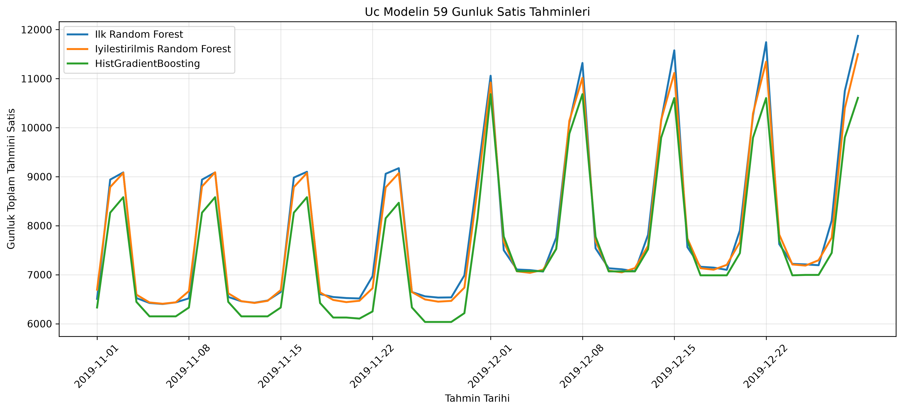

### Tahmin Dosyaları

- [İlk Random Forest tahminleri](reports/csv/59_gunluk_satis_tahminleri.csv)
- [İyileştirilmiş Random Forest tahminleri](reports/csv/iyilestirilmis_rf_59_gunluk_tahmin.csv)
- [HistGradientBoosting tahminleri](reports/csv/hist_gradient_59_gunluk_tahmin.csv)

Tahmin sonuçları CSV dosyalarının yanı sıra PostgreSQL veritabanında da saklanmaktadır.

## 10. Mağaza Bazlı Analizler

Modellerin tahminleri mağaza bazında karşılaştırılmıştır.

İyileştirilmiş Random Forest ve HistGradientBoosting modelleri arasında en yüksek mutlak tahmin farkının görüldüğü mağazalar:

| Mağaza | Mutlak Tahmin Farkı |
|---|---:|
| S0085 | 5.553,19 |
| S0097 | 1.856,39 |
| S0038 | 1.561,38 |
| S0020 | 1.339,84 |
| S0028 | 853,28 |

En yüksek yüzdesel fark S0006 mağazasında HistGradientBoosting tahmini referans alınarak %37,60 olarak hesaplanmıştır.

### S0085 Mağazası

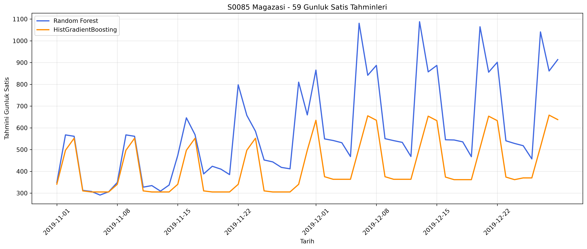

### S0020 Mağazası


Bu grafikler ilk Random Forest ve HistGradientBoosting modellerinin mağaza bazlı tahminlerini göstermektedir.

## 11. Veritabanı Performans Analizi

magaza_gunluk tablosunda magaza_id ve tarih sütunları üzerinde birleşik B-tree indeksi oluşturulmuştur.

```sql
CREATE INDEX idx_magaza_gunluk_magaza_tarih
ON magaza_gunluk (magaza_id, tarih);
```

İndeks kullanımının sorgu performansına etkisi EXPLAIN ANALYZE ve BUFFERS kullanılarak incelenmiştir.

### Performans Sonuçları

| Ölçüm | İndeksli | İndeks Kullanımı Kapalı |
|---|---:|---:|
| Birinci ölçüm | 0,194 ms | 285,761 ms |
| İkinci ölçüm | 0,196 ms | 259,638 ms |
| Üçüncü ölçüm | 0,201 ms | 236,247 ms |
| Ortalama | 0,197 ms | 260,549 ms |
| Bellek bloğu erişimi | 64 | 3310 |

Seçilen sorguda indeks kullanımı sayesinde çalışma süresi yaklaşık %99,92 azalmıştır.

Performans ölçümleri sırasında mevcut indeks silinmemiştir. İndeks kullanımı geçici olarak kapatılmış ve işlem sonunda ayarlar geri alınmıştır.

Bu sonuçlar kullanılan sorguya, önbellek durumuna ve çalışma ortamına özeldir. Model eğitim hızında aynı oranda iyileşme olduğu anlamına gelmemektedir.

İlişkisel tablo yapısı ve indeks kullanımı, model için gerekli verilerin daha verimli sorgulanmasına katkı sağlayabilir.

## 12. Kullanıcı Arayüzü

Proje için Streamlit kullanılarak web tabanlı bir kullanıcı arayüzü geliştirilmiştir.

Arayüz sade ve koyu temalı olarak tasarlanmıştır.

Satış tahminleri, mağaza analizleri ve kayıt sayıları doğrudan PostgreSQL veritabanından alınmaktadır. Model performans ve indeks performans değerleri ise daha önce gerçekleştirilen ölçümlere dayanmaktadır.

### Arayüz Özellikleri

- Otomatik PostgreSQL bağlantısı
- Satış, mağaza ve ürün istatistikleri
- Makine öğrenmesi modeli seçimi
- Mağaza seçimi
- Tarih aralığı filtreleme
- Günlük satış tahmin grafikleri
- Model performans karşılaştırması
- Mağaza bazlı model karşılaştırması
- Veritabanı kayıt sayıları
- İndeks performans analizi
- CSV dosyası indirme

### 12.1. Genel Bakış

Satış, mağaza ve ürün sayıları doğrudan PostgreSQL üzerinden alınmaktadır.

Projenin genel bilgileri ve kullanılan makine öğrenmesi modelleri gösterilmektedir.

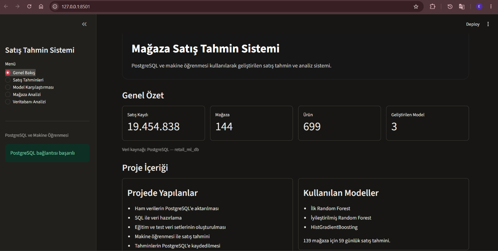

### 12.2. Satış Tahminleri

Kullanıcı model, mağaza ve tarih aralığı seçerek satış tahminlerini inceleyebilir.

Toplam tahmini satış miktarı, mağaza sayısı ve tahmin kayıt sayısı gösterilmektedir.

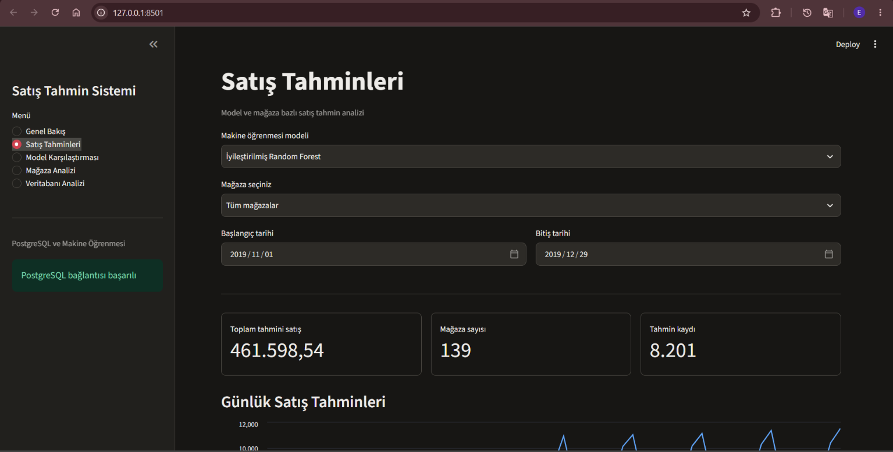

Günlük satış tahminleri grafiklerle görselleştirilmektedir.

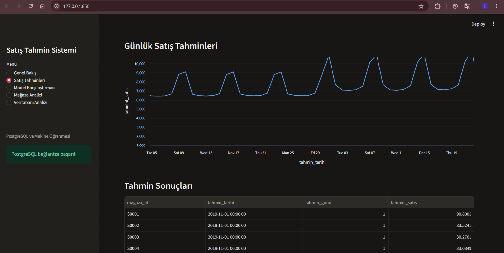

Tahmin sonuçları tablo şeklinde görüntülenebilir ve CSV olarak indirilebilir.

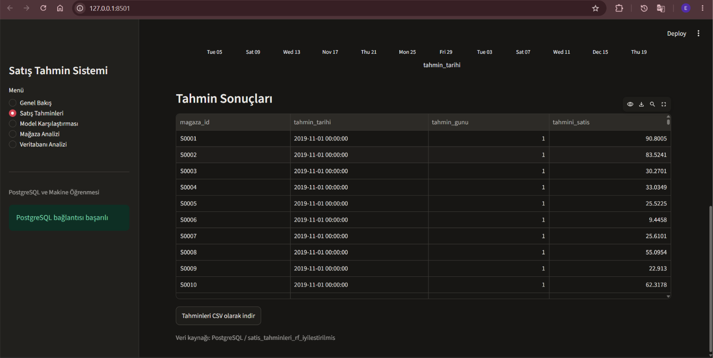

### 12.3. Model Karşılaştırması

Üç makine öğrenmesi modelinin daha önce ölçülen MAE, RMSE ve R² değerleri karşılaştırılmaktadır.

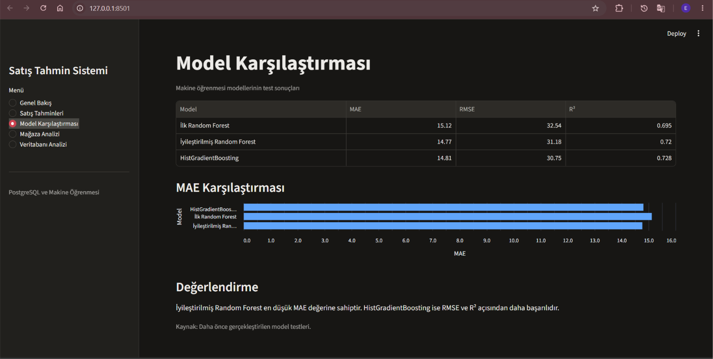

### 12.4. Mağaza Analizi

Seçilen mağaza için üç modelin toplam ve günlük satış tahminleri karşılaştırılmaktadır.

Veriler doğrudan PostgreSQL tahmin tablolarından alınmaktadır.

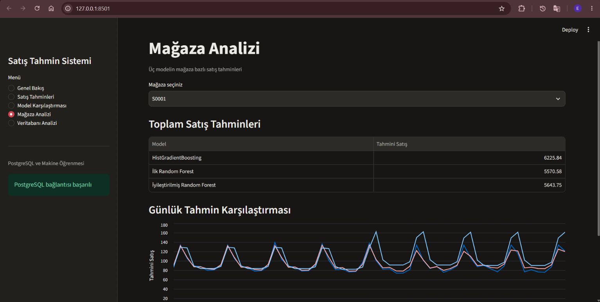

### 12.5. Veritabanı Analizi

PostgreSQL veritabanındaki toplam tablo sayısı ve temel tabloların gerçek kayıt sayıları gösterilmektedir.

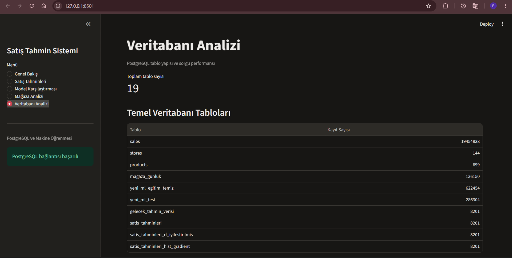

Daha önce gerçekleştirilen indeksli ve indeks kullanımı kapalı sorgu performans ölçümleri karşılaştırılmaktadır.

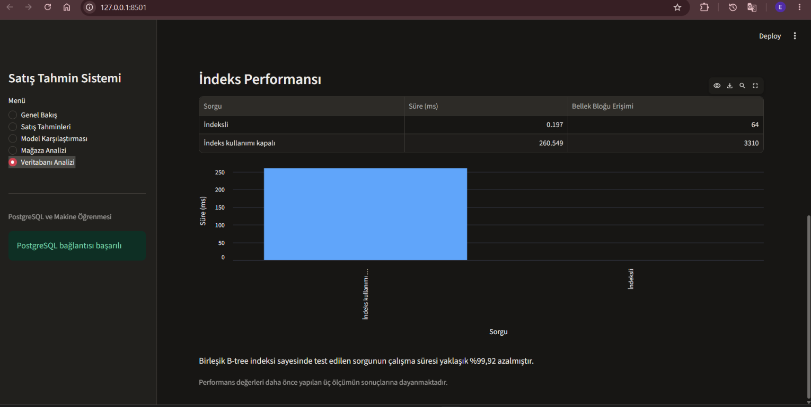

## 13. Proje Klasör Yapısı

```text
veritabani_ml_projesi/
├── data/
├── docs/
│   ├── kurulum.md
│   ├── mimari_diyagram.png
│   └── mimari_diyagram.svg
├── models/
├── notebooks/
├── reports/
│   ├── arayuz/
│   ├── csv/
│   ├── grafikler/
│   ├── gunluk_raporlar/
│   └── proje_raporu.pdf
├── sql/
│   ├── schema.sql
│   ├── veri_hazirlama.sql
│   ├── egitim_test_hazirlama.sql
│   ├── gelecek_tahmin_hazirlama.sql
│   ├── analiz_sorgulari.sql
│   └── performans_analizi.sql
├── src/
│   ├── arayuz_tahminleri.py
│   ├── arayuz_magaza.py
│   ├── arayuz_veritabani.py
│   └── Diger Python kaynak dosyalari
├── .gitignore
├── app.py
├── README.md
└── requirements.txt
```

| Klasör veya Dosya | İçerik |
|---|---|
| data | Ham veri dosyaları |
| models | Eğitilmiş makine öğrenmesi modelleri |
| notebooks | Jupyter Notebook çalışma alanı |
| reports/arayuz | Kullanıcı arayüzü ekran görüntüleri |
| reports/csv | Tahmin ve analiz sonuçları |
| reports/grafikler | Veri görselleştirmeleri |
| reports/gunluk_raporlar | Geliştirme ve analiz raporları |
| sql | Veritabanı şeması, veri hazırlama ve analiz sorguları |
| docs | Kurulum rehberi |
| src | Python kaynak kodları |
| app.py | Streamlit uygulamasının başlangıç dosyası |
| requirements.txt | Python paket gereksinimleri |

Ham veri dosyaları ve eğitilmiş modeller GitHub deposuna dahil edilmemiştir.

## 14. Kurulum ve Çalıştırma

### Sistem Gereksinimleri

- Python 3.13
- PostgreSQL 18
- Git
- pgAdmin 4 (isteğe bağlı)

### Projenin İndirilmesi

```bash
git clone https://github.com/ervakurt/veritabani-ml-satis-tahmini.git
cd veritabani-ml-satis-tahmini
```

### Python Ortamının Hazırlanması

```powershell
python -m venv venv
.\venv\Scripts\Activate.ps1
python -m pip install -r requirements.txt
```

### PostgreSQL Bağlantı Bilgileri

| Parametre | Değer |
|---|---|
| Host | localhost |
| Port | 5432 |
| Database | retail_ml_db |
| User | postgres |

Veritabanının oluşturulması, ham verilerin aktarılması, SQL sorgularının çalıştırılması, model eğitimi ve satış tahminlerinin kaydedilmesi ayrıntılı kurulum rehberinde açıklanmıştır.

**[Kurulum ve Çalıştırma Rehberi](docs/kurulum.md)**

### Streamlit Bağlantı Ayarları

Arayüzün çalıştırılması için PostgreSQL sunucusu açık olmalı ve gerekli veritabanı tabloları hazırlanmış olmalıdır.

Proje ana dizininde .streamlit isimli bir klasör oluşturulur.

Bu klasör içerisinde secrets.toml isimli bir dosya oluşturulur.

```toml
[postgresql]
password = "POSTGRESQL_SIFRENIZ"
```

Örnek şifre yerine yerel PostgreSQL şifresi yazılmalıdır.

Bu dosya .gitignore ile GitHub deposundan hariç tutulmaktadır.

### Kullanıcı Arayüzünün Başlatılması

```powershell
python -m streamlit run app.py --server.address 127.0.0.1
```

Uygulama adresi:

http://127.0.0.1:8501

Uygulama yerel bilgisayarda çalışmaktadır. GitHub üzerinden kaynak kodlarına ve ekran görüntülerine erişilebilir.

## 15. Test ve Doğrulama

### Python ve Model Testleri

Proje kapsamında aşağıdaki kontroller gerçekleştirilmiştir:

- Python dosyalarının sözdizimi kontrolü
- Üç modelin satış tahmini oluşturma testi
- CSV dosyalarının oluşturulması
- Model performanslarının karşılaştırılması
- Grafik oluşturma testleri
- PostgreSQL kayıt işlemleri
- Veritabanına yeniden kayıt sırasında mükerrer kayıt oluşmadığının kontrolü

Eksik sütun, boş değer ve tekrar eden kayıtları kontrol eden mekanizmalar eklenmiştir.

Üç modelin tahminlerinin PostgreSQL'e kaydedilmesi test edilmiş ve her tahmin tablosunda 8.201 kayıt bulunduğu doğrulanmıştır.

### Ayrı Veritabanında Kurulum Testi

Aynı PostgreSQL sunucusunda boş bir test veritabanı oluşturularak veri aktarımı ve SQL veri hazırlama aşamaları yeniden çalıştırılmıştır.

| Kontrol | Sonuç |
|---|---:|
| Oluşturulan tablo | 19 |
| Aktarılan ürün | 699 |
| Aktarılan mağaza | 144 |
| Aktarılan satış kaydı | 19.454.838 |
| İçeriği eşleşen veri hazırlama tabloları | 9/9 |

### Veri Hazırlama Tablolarının Doğrulanması

| Tablo | Kayıt Sayısı | Sonuç |
|---|---:|---|
| magaza_gunluk | 136.150 | Eşleşiyor |
| tahmin_donemleri | 123 | Eşleşiyor |
| donem_gecmis_ozet | 16.448 | Eşleşiyor |
| donem_gecmis_temiz | 16.076 | Eşleşiyor |
| yeni_ml_egitim | 945.746 | Eşleşiyor |
| yeni_ml_egitim_temiz | 622.454 | Eşleşiyor |
| yeni_ml_test | 286.304 | Eşleşiyor |
| magaza_gecmis_ozet | 144 | Eşleşiyor |
| gelecek_tahmin_verisi | 8.201 | Eşleşiyor |

Dokuz veri hazırlama tablosunun kayıt sayıları ve MD5 içerik özetleri asıl veritabanıyla eşleşmiştir.

Ürün ve mağaza verilerinin tekrar yüklenmesinde mükerrer kayıt oluşmadığı doğrulanmıştır.

Dolu satış tablosuna yeniden veri aktarılması engellenmiştir.

Aktarım sırasında hata oluşması durumundaki geri alma mekanizması kodda bulunmaktadır ancak aktarım ortasında hata oluşturularak ayrıca test edilmemiştir.

### Kullanıcı Arayüzü Testleri

| Kontrol | Sonuç |
|---|---|
| Streamlit kurulumu | Başarılı |
| Python paket uyumluluğu | Başarılı |
| PostgreSQL bağlantısı | Başarılı |
| Genel Bakış sayfası | Başarılı |
| Satış Tahminleri sayfasının temel çalışması | Başarılı |
| Model Karşılaştırması sayfası | Başarılı |
| Mağaza Analizi sayfası | Başarılı |
| Veritabanı Analizi sayfası | Başarılı |
| Otomatik PostgreSQL bağlantısı | Başarılı |
| Python sözdizimi kontrolü | Başarılı |
| Şifre dosyasının Git dışında tutulması | Başarılı |
| Sekiz PNG ekran görüntüsünün dosya doğrulaması | Başarılı |

HistGradientBoosting modelinin arayüzde gösterilen toplam satış tahmini, mağaza sayısı ve kayıt sayısı önceki sonuçlarla eşleşmiştir.

Üç modelin genel tahmin sonuçları, mağaza seçimi, tarih aralığı filtreleme ve CSV indirme işlemleri test edilmiştir. Seçilen test senaryolarında beklenen sonuçlar elde edilmiştir.

Son kod düzenlemelerinden sonra mevcut eğitilmiş modeller kullanılmıştır. Modellerin sıfırdan yeniden eğitilmesi gerçekleştirilmemiştir.

## 16. Güvenlik ve Yapılandırma

Veritabanı şifresi arayüzün kaynak koduna yazılmamaktadır.

Streamlit bağlantı şifresi yerel secrets.toml dosyasında saklanmaktadır.

Arayüzün PostgreSQL bağlantılarında salt okunur oturumlar kullanılmaktadır.

Model ve mağaza filtrelerinde parametreli SQL sorguları kullanılmaktadır.

Aşağıdaki dosya ve klasörler GitHub deposuna dahil edilmemektedir:

- Ham veri dosyaları
- Eğitilmiş model dosyaları
- Python sanal ortamı
- Geçici Python dosyaları
- Streamlit şifre dosyası

Uygulama yerel kullanım için hazırlanmıştır. Üretim ortamında ayrı yetkilere sahip bir veritabanı kullanıcısı ve ek güvenlik mekanizmaları tercih edilmelidir.
## 17. Sınırlılıklar ve Gelecek Çalışmalar

- Tahmin sonuçları ilgili dönemin gerçek satış verileriyle karşılaştırılabilir.
- Kampanya, tatil ve fiyat bilgileri modele dahil edilebilir.
- Güncel satış verileriyle otomatik tahmin sistemi geliştirilebilir.
- Yeni bir ortamda uçtan uca kurulum ve model eğitimi test edilebilir.

## 18. Sonuç

Bu projede PostgreSQL veritabanı ile makine öğrenmesi teknolojilerini bir arada kullanarak mağaza satış tahmin sistemi geliştirdim.

19 milyondan fazla satış kaydını PostgreSQL'e aktardım ve SQL sorgularıyla makine öğrenmesi için gerekli veri setlerini hazırladım.

Üç farklı model oluşturdum ve modellerin performanslarını farklı değerlendirme yöntemleriyle karşılaştırdım.

139 mağaza için oluşturduğum 59 günlük satış tahminlerini CSV dosyalarına ve PostgreSQL veritabanına kaydettim.

Veritabanı indekslerinin sorgu performansı üzerindeki etkisini inceledim.

Ayrıca Streamlit kullanarak kullanıcıların satış tahminlerini inceleyebildiği, mağaza ve model bazlı karşılaştırmalar yapabildiği web tabanlı bir arayüz geliştirdim.

Bu proje sayesinde veritabanı yönetimi, veri analizi, makine öğrenmesi, model değerlendirme, sorgu optimizasyonu ve kullanıcı arayüzü geliştirme konularında uygulamalı deneyim kazandım.

[Ayrıntılı Proje Raporu](reports/proje_raporu.txt)

## 19. Geliştirici

**Erva Kurt**

Biruni Üniversitesi — Yazılım Mühendisliği

[GitHub Profili](https://github.com/ervakurt)

## Proje Raporu ve Medium Yazısı
- [Proje Raporu(PDF)](reports/proje_raporu.pdf)
- [Medium Makalesi](https://medium.com/p/fe9510b7775c)
