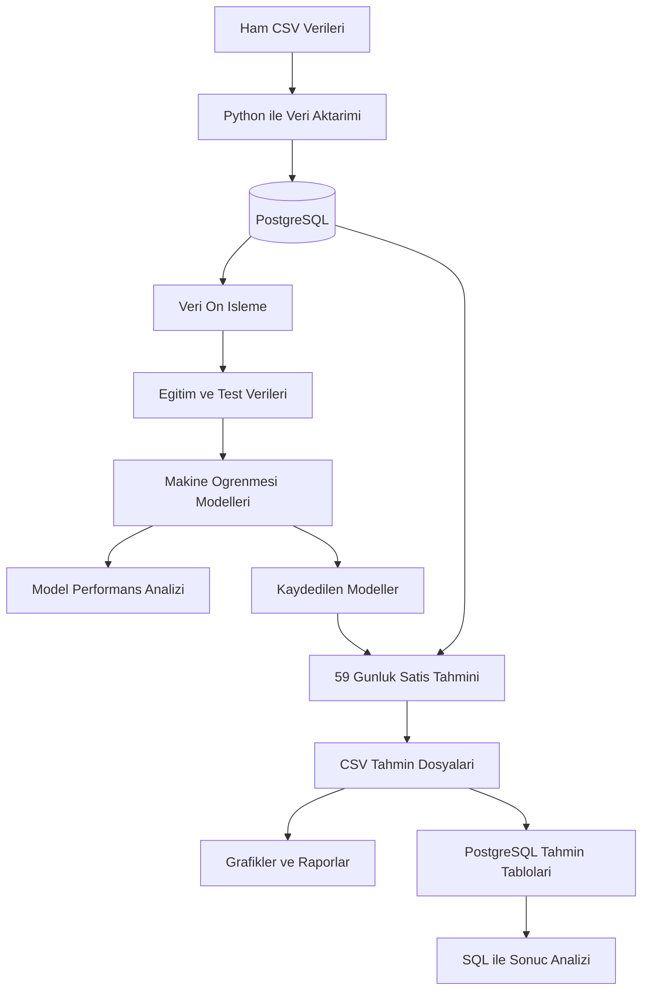
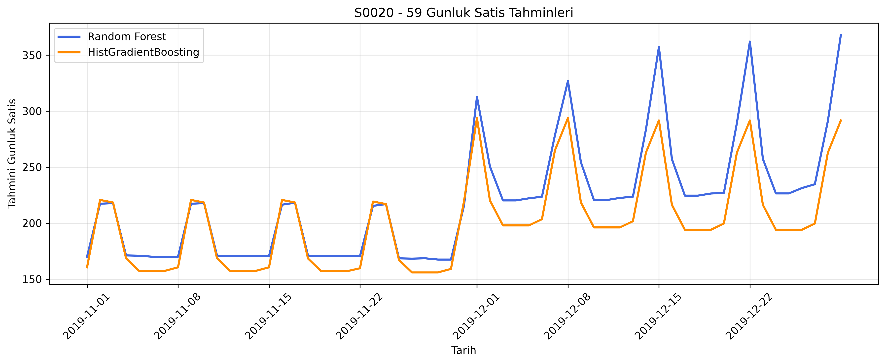

# PostgreSQL ve Makine Öğrenmesi ile Mağaza Satış Tahmini

**Python | PostgreSQL 18 | Scikit-learn | Veri Analizi | Machine Learning**

## 1. Proje Hakkında

Bu projede geçmiş satış verilerini kullanarak mağazaların gelecekteki satış miktarlarını tahmin eden bir sistem geliştirdim.

PostgreSQL veritabanı ile Python tabanlı makine öğrenmesi modellerini entegre ederek veri aktarımı, veri ön işleme, model eğitimi, performans değerlendirmesi, satış tahmini ve sonuçların görselleştirilmesi aşamalarını gerçekleştirdim.

### Projenin öne çıkan özellikleri

- Yaklaşık 19,4 milyon satış kaydı
- 144 mağaza ve 699 üründen oluşan veri seti
- Üç farklı makine öğrenmesi modeli
- 139 mağaza için 59 günlük satış tahmini
- Her model için 8.201 tahmin
- PostgreSQL ve Python entegrasyonu
- Mağaza bazlı performans analizleri
- Farklı model doğrulama yöntemleri

## 2. Kullanılan Teknolojiler

| Teknoloji | Kullanım amacı |
|---|---|
| Python | Veri işleme ve model geliştirme |
| PostgreSQL 18 | Veri saklama ve SQL analizleri |
| pandas | Veri hazırlama ve analiz |
| NumPy | Sayısal hesaplamalar |
| scikit-learn | Makine öğrenmesi |
| Matplotlib | Veri görselleştirme |
| psycopg2 | PostgreSQL bağlantısı |
| joblib | Model kaydetme ve yükleme |
| pgAdmin 4 | Veritabanı yönetimi |
| Visual Studio Code | Kod geliştirme |
| Git ve GitHub | Sürüm kontrolü |

## 3. Veri Seti

Projede 2017–2019 yılları arasındaki satış, mağaza ve ürün verileri kullanılmıştır.

| Veri grubu | Kayıt sayısı |
|---|---:|
| Satış verileri | Yaklaşık 19,4 milyon |
| Mağaza verileri | 144 |
| Ürün verileri | 699 |
| Eğitim verileri | 622.454 |
| Test verileri | 286.304 |
| Tahmin yapılan mağazalar | 139 |

Mağaza verilerinde mağaza kimliği, mağaza türü, mağaza büyüklüğü ve şehir bilgileri bulunmaktadır.

Ürün verilerinde ürün kimliği, fiziksel boyutlar ve kategori hiyerarşisi bilgileri bulunmaktadır.

## 4. Sistem Mimarisi

Proje, veritabanı ve makine öğrenmesi arasında iki yönlü veri akışı sağlayacak şekilde geliştirilmiştir.



## 5. PostgreSQL Entegrasyonu

Projede `retail_ml_db` isimli PostgreSQL veritabanı kullanılmıştır.

Ham veriler Python üzerinden PostgreSQL'e aktarılmıştır. Eğitim ve test verileri SQL sorgularıyla alınmış, makine öğrenmesi modellerinin oluşturduğu tahminler tekrar veritabanına kaydedilmiştir.

### Makine öğrenmesi veri yapıları

| Veri yapısı | Açıklama |
|---|---|
| `yeni_ml_egitim_temiz` | Model eğitim verileri |
| `yeni_ml_test` | Model test verileri |
| `gelecek_tahmin_verisi` | Gelecek satış tahmini verileri |

### Tahmin tabloları

| Tablo | Açıklama |
|---|---|
| `satis_tahminleri` | İlk Random Forest tahminleri |
| `satis_tahminleri_rf_iyilestirilmis` | İyileştirilmiş Random Forest tahminleri |
| `satis_tahminleri_hist_gradient` | HistGradientBoosting tahminleri |

Veritabanı şeması: [schema.sql](sql/schema.sql)

## 6. Veri Ön İşleme

Model eğitimi öncesinde satış verileri hazırlanmış ve eğitim-test ayrımı tarihsel olarak gerçekleştirilmiştir.

### Eğitim ve test dönemleri

| Veri grubu | Başlangıç | Bitiş |
|---|---|---|
| Eğitim | 01.05.2017 | 31.12.2018 |
| Test | 07.01.2019 | 30.10.2019 |
| Gelecek tahmini | 01.11.2019 | 29.12.2019 |

### Modelde kullanılan özellikler

- Mağaza kimliği
- Tahmin günü
- Haftanın günü
- Ay
- Geçmiş 7 günlük satış ortalaması
- Geçmiş 28 günlük satış ortalaması
- Geçmiş 59 günlük satış ortalaması

Mağaza kimlikleri One-Hot Encoding yöntemiyle sayısal sütunlara dönüştürülmüştür.

Geçmiş satış ortalamalarının doğruluğu 4.860 grup üzerinde kontrol edilmiştir.

## 7. Makine Öğrenmesi Modelleri

Projede üç farklı model geliştirilmiştir.

### İlk Random Forest

```python
RandomForestRegressor(
    n_estimators=50,
    max_depth=15,
    random_state=42,
    n_jobs=-1
)
```

### İyileştirilmiş Random Forest

```python
RandomForestRegressor(
    n_estimators=100,
    max_depth=20,
    min_samples_leaf=5,
    max_features=0.8,
    random_state=42,
    n_jobs=-1
)
```

### HistGradientBoosting

```python
HistGradientBoostingRegressor(
    max_iter=200,
    max_depth=10,
    learning_rate=0.05,
    min_samples_leaf=20,
    random_state=42
)
```

## 8. Model Performans Karşılaştırması

Modeller MAE, RMSE ve R² metrikleri kullanılarak değerlendirilmiştir.

- MAE: Ortalama mutlak tahmin hatası
- RMSE: Büyük tahmin hatalarına daha duyarlı hata metriği
- R²: Modelin hedef değişkendeki değişkenliği açıklama düzeyini gösteren metrik

### Genel test sonuçları

| Model | MAE | RMSE | R² |
|---|---:|---:|---:|
| İlk Random Forest | 15,12 | 32,54 | 0,695 |
| İyileştirilmiş Random Forest | **14,77** | 31,18 | 0,720 |
| HistGradientBoosting | 14,81 | **30,75** | **0,728** |

Random Forest modelinin parametreleri değiştirilerek tahmin hataları azaltılmıştır.

HistGradientBoosting modeli genel değerlendirmede daha düşük RMSE ve daha yüksek R² değeri elde etmiştir.

### Benzersiz tahmin hedefleri üzerinden değerlendirme

286.304 test kaydında 41.369 benzersiz mağaza ve tahmin tarihi birleşimi bulunmaktadır.

Tekrarlanan hedeflerin değerlendirme üzerindeki etkisini incelemek için ek bir karşılaştırma yapılmıştır.

| Model | MAE | RMSE | R² |
|---|---:|---:|---:|
| İyileştirilmiş Random Forest | **14,03** | **29,12** | **0,752** |
| HistGradientBoosting | 14,32 | 29,36 | 0,748 |

### Tek başlangıç tarihi üzerinden değerlendirme

2 Eylül 2019 başlangıç tarihi için 8.357 test kaydı değerlendirilmiştir.

| Model | MAE | RMSE | R² |
|---|---:|---:|---:|
| İyileştirilmiş Random Forest | **14,61** | **25,18** | **0,786** |
| HistGradientBoosting | 15,22 | 25,92 | 0,773 |

Ek değerlendirmelerde iyileştirilmiş Random Forest daha başarılı sonuçlar vermiştir. Bu nedenle güçlü bir model adayı olarak belirlenmiştir.

## 9. Gelecek Satış Tahminleri

139 mağaza için 1 Kasım 2019 ile 29 Aralık 2019 arasındaki 59 günlük satış miktarları tahmin edilmiştir.

Her model toplam 8.201 satış tahmini oluşturmuştur.

| Model | Toplam tahmin sayısı | Toplam tahmini satış |
|---|---:|---:|
| İlk Random Forest | 8.201 | 465.375,62 |
| İyileştirilmiş Random Forest | 8.201 | 461.598,54 |
| HistGradientBoosting | 8.201 | 443.460,94 |

### Üç modelin günlük satış tahminleri


### Tahmin dosyaları

- [İlk Random Forest tahminleri](reports/csv/59_gunluk_satis_tahminleri.csv)
- [İyileştirilmiş Random Forest tahminleri](reports/csv/iyilestirilmis_rf_59_gunluk_tahmin.csv)
- [HistGradientBoosting tahminleri](reports/csv/hist_gradient_59_gunluk_tahmin.csv)

## 10. Mağaza Bazlı Analizler

Modellerin tahminleri mağaza bazında karşılaştırılmıştır.

İyileştirilmiş Random Forest ve HistGradientBoosting modelleri arasında en yüksek mutlak tahmin farkının görüldüğü mağazalar:

| Mağaza | Mutlak tahmin farkı |
|---|---:|
| S0085 | 5.553,19 |
| S0097 | 1.856,39 |
| S0038 | 1.561,38 |
| S0020 | 1.339,84 |
| S0028 | 853,28 |

En yüksek yüzdesel fark S0006 mağazasında %37,60 olarak hesaplanmıştır.

### S0085 mağazası


### S0020 mağazası



Bu grafikler ilk Random Forest ve HistGradientBoosting modellerinin mağaza bazlı tahminlerini göstermektedir.

## 11. Proje Klasör Yapısı

```text
veritabani_ml_projesi/
├── data/
├── models/
├── notebooks/
├── reports/
│   ├── csv/
│   ├── grafikler/
│   ├── gunluk_raporlar/
│   ├── proje_raporu.txt
│   └── proje_raporu_taslak.txt
├── sql/
│   └── schema.sql
├── src/
├── .gitignore
├── README.md
└── requirements.txt
```

| Klasör | İçerik |
|---|---|
| data | Ham veri dosyaları |
| models | Eğitilmiş makine öğrenmesi modelleri |
| notebooks | Jupyter Notebook çalışma alanı |
| reports/csv | Tahmin ve analiz sonuçları |
| reports/grafikler | Veri görselleştirmeleri |
| reports/gunluk_raporlar | Geliştirme ve analiz raporları |
| sql | Veritabanı şeması |
| src | Python kaynak kodları |

## 12. Kurulum ve Çalıştırma

Projenin çalıştırılması için Python 3.13 ve PostgreSQL 18 gereklidir.

Kurulum, veri aktarımı, model eğitimi ve satış tahmini adımları ayrıntılı kurulum rehberinde açıklanmıştır.

**[Kurulum ve Çalıştırma Rehberi](docs/kurulum.md)**

Ham veri dosyaları ve eğitilmiş modeller GitHub deposuna dahil edilmemiştir. Hazır tahmin sonuçları ve grafikler `reports/` klasöründe bulunmaktadır.


## 13. Test ve Doğrulama

Proje kapsamında aşağıdaki kontroller gerçekleştirilmiştir:

- Python dosyalarının sözdizimi kontrolü
- Üç modelin satış tahmini oluşturma testi
- CSV dosyalarının oluşturulması
- Model performanslarının karşılaştırılması
- Grafik oluşturma testleri
- PostgreSQL kayıt işlemleri
- Eksik sütun ve boş değer kontrolleri
- Tekrar eden kayıt kontrolleri
- Veritabanına yeniden kayıt sırasında mükerrer kayıt oluşmadığının kontrolü

İyileştirilmiş Random Forest ve HistGradientBoosting tahminlerinin PostgreSQL'e tekrar kaydedilmesi sonucunda her iki tabloda da 8.201 kayıt bulunduğu doğrulanmıştır.

Son kod düzenlemelerinden sonra mevcut eğitilmiş modeller kullanılmıştır. Modellerin sıfırdan yeniden eğitilmesi gerçekleştirilmemiştir.

## 14. Projenin Sınırlılıkları ve Gelecek Çalışmalar

- Gelecek satış tahminleri henüz ilgili dönemin gerçek satış sonuçlarıyla karşılaştırılmamıştır.
- Model performansları daha fazla tahmin başlangıç tarihi üzerinden değerlendirilebilir.
- Tatil, kampanya ve fiyat bilgileri gibi ek özellikler araştırılabilir.
- Model parametreleri farklı optimizasyon yöntemleriyle geliştirilebilir.
- PostgreSQL okuma bağlantıları SQLAlchemy kullanılarak iyileştirilebilir.
- Satış tahminlerinin görüntülenebileceği bir web arayüzü geliştirilebilir.

## 15. Sonuç

Bu projede PostgreSQL veritabanı ile makine öğrenmesi teknolojilerini bir arada kullanarak mağaza satış tahmin sistemi geliştirdim.

Geçmiş satış verilerini analiz ettim, üç farklı model oluşturdum ve modellerin performanslarını farklı değerlendirme yöntemleriyle karşılaştırdım.

139 mağaza için oluşturduğum 59 günlük satış tahminlerini CSV dosyalarına ve PostgreSQL veritabanına kaydettim. Sonuçları grafikler ve SQL sorguları üzerinden analiz ettim.

Bu proje sayesinde veritabanı yönetimi, veri analizi, makine öğrenmesi, model değerlendirme ve veri görselleştirme konularında uygulamalı deneyim kazandım.

[Ayrıntılı proje raporu](reports/proje_raporu.txt)

## 16. Geliştirici

**Erva Kurt**

Biruni Üniversitesi — Yazılım Mühendisliği

[GitHub Profili](https://github.com/ervakurt)